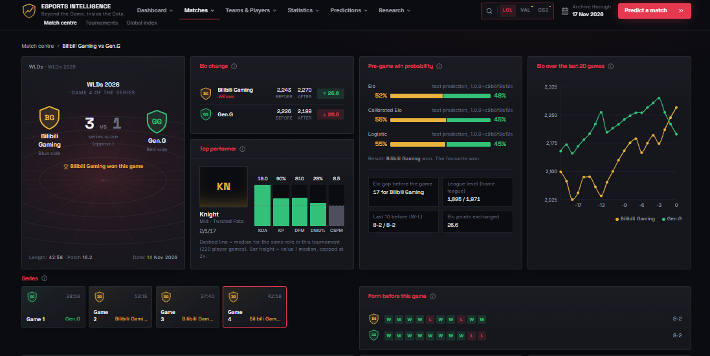
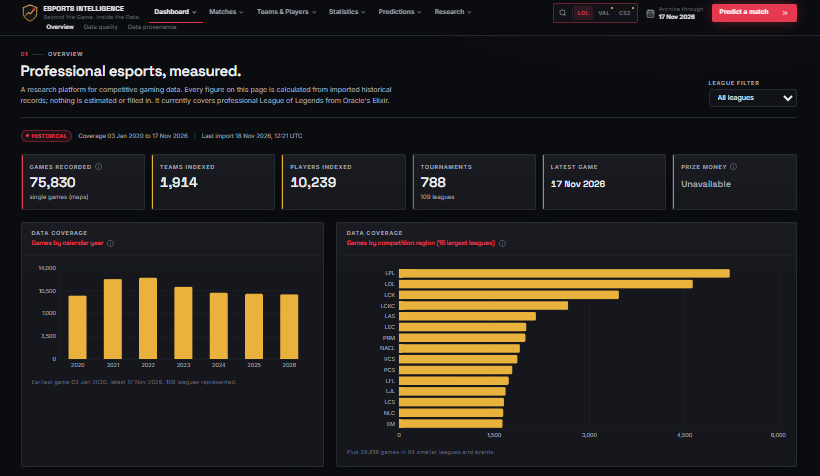
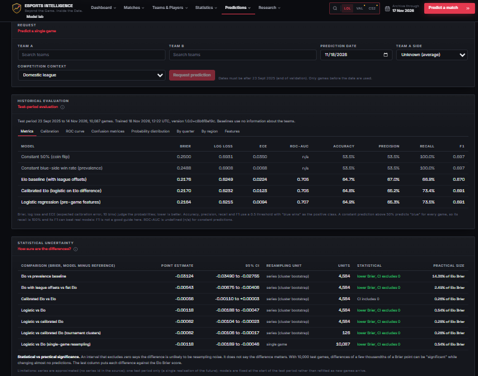

# Esports Intelligence

**Beyond the Game. Inside the Data.**



| Overview | Prediction lab |
|---|---|
|  |  |

A research-driven esports analytics platform built on 75,830 professional
League of Legends games (2020 to November 2026) from the public historical files of
[Oracle's Elixir](https://oracleselixir.com/tools/downloads). VALORANT and
Counter-Strike 2 have provider adapters but no verified data integration yet, and
the site says so instead of showing empty or invented numbers.

Central research question: *can machine learning predict professional League of
Legends game outcomes better than an Elo benchmark?*

## Key findings

Test period 23 Sep 2025 to 14 Nov 2026 (10,087 games), never used for fitting or tuning.

| Model | Brier (lower is better) | Accuracy |
|---|---|---|
| Constant blue-side win rate (baseline) | 0.2488 | 53.5% |
| Elo with league offsets | 0.2176 | 64.7% |
| Calibrated Elo | 0.2170 | 64.8% |
| Logistic regression (pre-game features) | 0.2164 | 64.9% |

- Logistic regression beats calibrated Elo: Brier difference -0.00062, 95% CI -0.00104 to
  -0.00023 (paired bootstrap over series; also holds with tournament clusters). The gain is
  statistically clear but small in practice: about 0.3% of the Brier score.
- The largest real improvement came from the rating design, not from machine learning:
  giving Elo separate league levels lowered the Brier score by 0.0054 against flat Elo.
- Tree models (gradient boosting, random forest) did not beat logistic regression on the
  validation period and were not deployed.

Full results: `docs/RESULTS_2020_2026.md` and `docs/AUDIT_AND_IMPROVEMENTS_v1.2.md`.

## What the platform shows

- **Overview:** data coverage, data quality indicators, Elo methodology, model comparison
  against baselines.
- **Match centre:** every game with Elo change, pre-game probabilities, series, recent form,
  scoreboards, team stats and objectives.
- **Prediction lab:** five models scored on the same test games, calibration, ROC, confusion
  matrices, probability distributions, bootstrap intervals, explained predictions and
  historical predictions.
- **Statistics:** competitive balance (HHI, Gini, Lorenz, Noll-Scully) by league and season,
  champion placements, Elo trajectories, consistency, player metrics by role and season.
- **Research and data:** three research reports, data quality report, data provenance and a
  Data Explorer with CSV downloads.

## Hosting

Hybrid: the default views of every page are pre-computed into a static snapshot served by the
website host, so they load instantly at any time; other requests go to the live API, which is
kept awake by a free uptime monitor. See `docs/deployment.md`.

## What is in the box

| Part | Folder | Stack |
|---|---|---|
| Web app | `frontend/` | Next.js 15 (App Router), React 19, TypeScript, Tailwind, Recharts, React Query |
| API | `backend/app/` | FastAPI, Pydantic, SQLAlchemy 2, Alembic |
| Database | `backend/alembic/` | PostgreSQL (SQLite works for tests) |
| Ingestion pipeline | `pipelines/oracle_elixir/` | pandas: acquire, inspect, clean, validate, transform, load |
| Ratings and models | `machine_learning/` | Elo with league offsets, calibrated Elo, logistic regression (scikit-learn), evaluation |
| Economics / statistics | `analytics/` | HHI, Gini, Lorenz, Noll-Scully, persistence, upset rate |
| Research reports | `backend/app/services/research.py` | Generated from computed outputs |
| Provider adapters | `backend/app/providers/` | Riot, GRID, PandaScore (pending) |
| Tests | `tests/`, `frontend/tests/` | pytest, Vitest + Testing Library |
| Docs | `docs/` | Architecture, database, API, methodology, deployment, reports |

## Quick start (local)

Requirements: Python 3.12+, Node 22+, PostgreSQL 14+ (or Docker).

```bash
cp .env.example .env              # set DATABASE_URL
make install                      # pip + npm
make db                           # create tables (Alembic)

# 1. Download yearly CSV files from https://oracleselixir.com/tools/downloads
# 2. Import, clean, validate and load them; then train models and run analytics
make all FILES="~/Downloads/2024_LoL_esports_match_data_from_OraclesElixir.csv ~/Downloads/2025_LoL_esports_match_data_from_OraclesElixir.csv"

make api                          # http://localhost:8000/docs
make web                          # http://localhost:3000
```

With Docker: put the CSV files in `./data/raw/oracles_elixir/`, then run
`docker compose build`,
`docker compose run --rm api make all FILES="/app/data/raw/oracles_elixir/*.csv"`
and `docker compose up`. On Git Bash for Windows, prefix the `run` command with
`MSYS_NO_PATHCONV=1`.

Use at least two seasons. Models need 500 training games and 200 test games
after the burn-in, or they stay switched off with an explanation.

## Data integrity rules (enforced in code)

- Only values computed from imported records are shown. Missing values are
  `null` and display as "n/a" or "Unavailable", never as 0.
- One match = one game. Player rows are never counted as games.
- Train, validation and test periods are split by date, never at random; features use
  only games before each prediction.
- Every excluded row has a written reason (`data/reports/exclusions.csv`).
- Every API response carries `data_status`, `data_type`, source and sample period.
- Predictions are refused for dates inside the training/validation period and
  for teams with fewer than 5 earlier games.
- No prize money, country, or live data is shown, because the source has none.

## Tests

```bash
make test                                  # pytest + tsc + vitest
TEST_POSTGRES_URL=postgresql+psycopg://... python -m pytest   # adds the Postgres migration test
```

Tests use a clearly labelled SYNTHETIC fixture (`tests/fixtures/make_oe_fixture.py`,
all names start with `SYNTH`). It never enters a production database.

## Licensing of data

Oracle's Elixir data is provided free of charge for non-commercial use by
analysts, commentators and fans; game statistics are the property of Riot
Games. Raw files are **not** redistributed in this repository; the pipeline
re-creates everything from the files you download. See `docs/data_sources.md`.
Not affiliated with Riot Games.

## Documentation

`docs/runbook.md`, `docs/architecture.md`, `docs/database.md`, `docs/api.md`,
`docs/data_sources.md`, `docs/data_dictionary.md`, `docs/methodology.md`,
`docs/RESULTS_2020_2026.md`, `docs/AUDIT_AND_IMPROVEMENTS_v1.2.md`,
`docs/deployment.md`, `docs/DEVELOPMENT_REPORT.md`.

## Author

Nahian Ibnat
